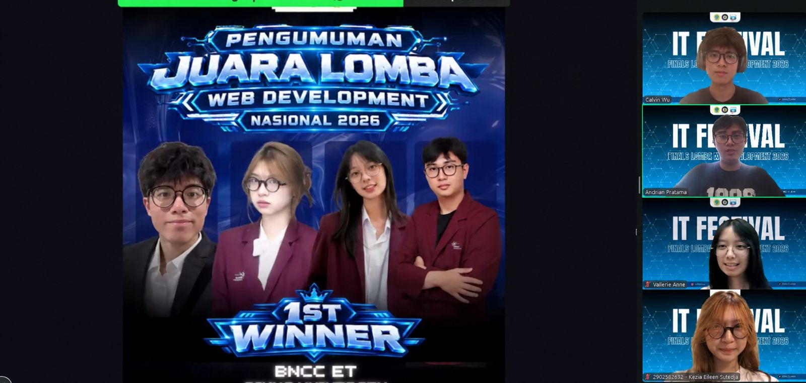

<p align="center">
  
</p>

# OMORI Website

**A Dive Into Omori's Headspace**

Omori Website mengembangkan website revamp OMORI untuk kompetisi. Proyek ini merupakan pengalaman web fan-made yang tidak resmi, dengan pembuka White Space, dialog bergaya game, photobook karakter 3D, serta musik dan efek suara.

---

## Achievement

**👑 1st Place — IT Fest UNW 2026 (Semarang)**

Kategori: **Web Development**

Proyek website OMORI meraih juara 1 kategori Web Development pada IT Fest UNW 2026 di Semarang.

<p align="center">
  
</p>

---

## Pengalaman Website

Website ini memperkenalkan dunia dan karakter OMORI melalui interaksi, bukan hanya teks dan gambar statis:

1. Pengunjung memulai pengalaman di White Space setelah aset selesai dimuat.
2. Scroll membawa pengunjung melewati pintu menuju pengenalan OMORI.
3. Dialog tampil bertahap dengan efek suara yang mengikuti teks.
4. Photobook 3D memperkenalkan karakter melalui halaman yang dapat dibalik dan foto yang dapat diperbesar.
5. Preview gameplay dan berita mengarahkan pengunjung untuk mengenal game aslinya.

Musik latar mengikuti bagian website, dengan kontrol volume dan pilihan untuk mengaktifkan ulang audio ketika pemutaran diblokir browser.

## Projects

| Project | Tanggung jawab |
| --- | --- |
| [Omori-FE](https://github.com/omori-website/Omori-FE) | Frontend untuk White Space, dialog, photobook karakter 3D, preview gameplay, berita, dan audio |
| [.github](https://github.com/omori-website/.github) | README profil organisasi dan dokumentasi pencapaian kompetisi |

## Technology Stack

| Layer | Teknologi |
| --- | --- |
| Web | React 19, TypeScript 6, Vite 8 |
| Styling | Tailwind CSS 4 dan CSS untuk layout serta transisi |
| 3D | Three.js dan WebGL2 untuk photobook karakter |
| Audio | Browser audio API untuk musik, efek suara, dan transisi volume |
| Quality | Oxlint dan pemeriksaan tipe TypeScript |

## Local Development

Jalankan dari folder repository `Omori-FE`:

```bash
npm ci
npm run dev
```

Pemeriksaan kualitas:

```bash
npm run lint
npm run build
```

Perintah build menjalankan pemeriksaan TypeScript sebelum membuat production build. Browser perlu mendukung WebGL2 untuk menampilkan photobook.

## Scope dan Kredit

Proyek ini adalah website frontend, bukan implementasi ulang game OMORI. Bagian gameplay menampilkan preview mekanik game aslinya; website ini tidak menyediakan sistem pertarungan atau permainan OMORI yang dapat dimainkan.

OMORI, karakter, cerita, nama, logo, serta aset game seperti ilustrasi, font, musik, dan efek suara merupakan milik OMOCAT dan pemegang hak masing-masing, bukan milik kontributor proyek ini. Proyek ini tidak berafiliasi, didukung, atau disponsori oleh OMOCAT. Penyertaan aset tidak memberikan izin untuk menggunakan ulang atau mendistribusikannya.

Dukung game aslinya melalui [website resmi OMORI](https://www.omori-game.com/).
